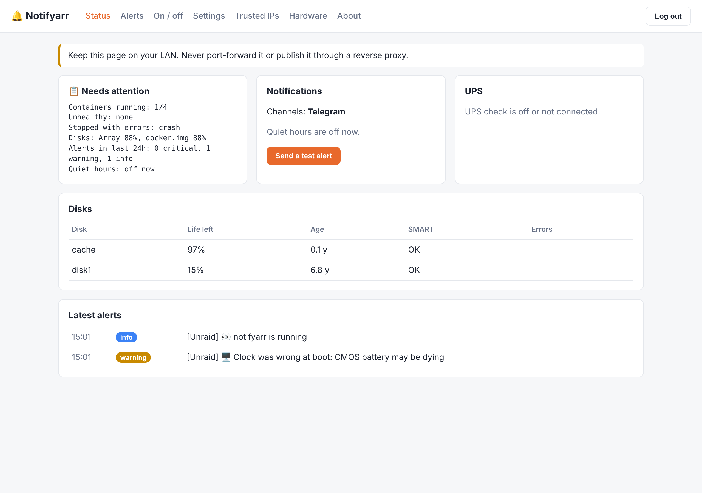
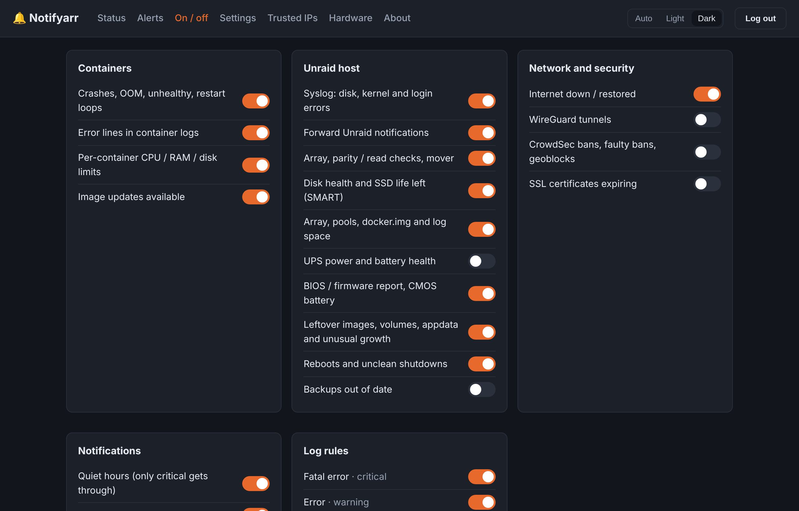

# Notifyarr

Alerts for your Docker containers and your Unraid server, sent to **Telegram** and/or **email**.

Notifyarr watches every container on the host (new ones too), the Unraid system itself and your network, and tells you when something needs attention: a crash, an unhealthy container, an error in a log, a failed login from an IP it doesn't know, a disk losing life, a parity check that's stuck, a power cut, and more. Every check can be switched off, and nothing is ever deleted or changed on your server.

> [!WARNING]
> **Never expose Notifyarr to the internet.** It can read the Docker socket and your Unraid logs. Don't port-forward it, don't put it behind a reverse proxy, and don't publish it with a tunnel. The web GUI only answers devices in your trusted (LAN) ranges and refuses requests that come through a proxy, but the safest setup is that nothing outside your LAN can reach it at all. Notifyarr only needs outbound connections to Telegram and your mail server.



## What it watches

| Area | What you get alerted about |
| --- | --- |
| Containers | Crashes (with the last log lines), out-of-memory kills, unhealthy healthchecks and recovery, restart loops, error lines in logs, CPU / RAM / disk I/O / disk size over a limit you set per container, image updates available |
| Security | Logins from IPs you haven't trusted, failed and unauthorised logins, first access from a new external IP on your reverse proxy, possible breach patterns, malware detections, CrowdSec bans, **faulty bans** (CrowdSec banning one of your trusted IPs), geoblocks, SSL certificates about to expire, GUI login failures |
| Unraid | Unraid's own notifications, syslog disk / filesystem / kernel errors, array state, disabled disks, disk read/write errors and temperature, parity checks, read checks and rebuilds that run too long or stop making progress, mover running too long |
| Disks | SMART failures, SSD / NVMe life left, growing reallocated / pending sectors, very old disks, array, pools, docker.img and the `/var/log` RAM disk filling up, oversized container logs |
| Power and hardware | Server rebooted, **unclean shutdown** (power cut or crash) with how long it was down, UPS on battery / low battery / power back, UPS battery health (replace flag, failed self-test, battery age, not charging fully), BIOS / board / disk firmware report with the vendor's update steps, CMOS battery hints |
| Network | Internet down and restored (alerts raised while offline are queued and sent when it's back), WireGuard tunnels down, web checks such as Unraid Connect remote access |
| Housekeeping | Backups that are out of date or failed, unused images, orphaned volumes, long-stopped containers, appdata folders no container uses, data piling up inside docker.img, appdata folders growing unusually fast. **Report only.** |
| Summary | A daily "all OK" (or "needs attention") message |

## Install on Unraid

### Option 1: Docker Compose Manager plugin

1. Install **Docker Compose Manager** from Community Apps.
2. Copy this repository into `/mnt/user/appdata/notifyarr` (for example `git clone https://github.com/p1zzm1ssile/Notifyarr /mnt/user/appdata/notifyarr` from the Unraid terminal).
3. Add a new stack pointing at that folder and press **Compose Up** (or run `docker compose up -d` in the folder).

### Option 2: Unraid template

Copy `unraid/notifyarr.xml` to `/boot/config/plugins/dockerMan/templates-user/`, then go to **Docker > Add Container**, pick **Notifyarr** and press **Apply**. The template uses the image `ghcr.io/p1zzm1ssile/notifyarr`, which is built by this repository's GitHub Action.

### First start

Open `http://<your-server>:8484` on your LAN. Notifyarr asks you to create a password for the GUI, then takes you to **Notifications**, where you fill in Telegram and/or email and press **Save and send a test alert**. No files to edit.

(If you'd rather use environment variables, see `.env.example`. Anything set in the GUI takes priority.)

### Setting up Telegram

1. Message **@BotFather**, send `/newbot`, and copy the token.
2. Send your new bot any message.
3. Open `https://api.telegram.org/bot<TOKEN>/getUpdates` and copy `"chat":{"id": ...}`.
4. Paste both into **Notifications > Telegram** in the GUI.

Info alerts arrive silently, warnings and critical alerts make a sound. The bot only obeys the chat ID you configured.

### Setting up email

Any SMTP server works. For Gmail use `smtp.gmail.com`, port `587`, `starttls`, and an **App Password** (Google account > Security > App passwords), not your normal password. Fill it in under **Notifications > Email**. You can choose to email only warnings and critical alerts while Telegram gets everything.

## Using it

### Which containers are watched

All of them, automatically, including containers you add later. To leave one out:

- add its name to `[containers] exclude` in `config.toml`, or
- give the container the label `notifyarr.enable=false` (Unraid: **Edit container > Add another Path, Port, Variable, Label**).

Use `[containers] include` if you'd rather watch only a few.

Per-container labels you can use:

| Label | Example | Effect |
| --- | --- | --- |
| `notifyarr.enable` | `false` | Don't watch this container |
| `notifyarr.ignore` | `Unable to connect to indexer` | Regex of log lines to ignore for this container |
| `notifyarr.cpu_percent` | `300` | Alert above 300% CPU (100 = one core) |
| `notifyarr.memory_mb` | `4096` | Alert above 4 GB RAM |
| `notifyarr.disk_io_mbps` | `200` | Alert above 200 MB/s disk I/O |
| `notifyarr.disk_size_gb` | `10` | Alert when its writable layer passes 10 GB |
| `notifyarr.for_minutes` | `10` | How long it must stay over the limit |

### Severity, quiet hours and repeats

Every alert is **info**, **warning** or **critical**. Quiet hours (`[quiet_hours]`, 23:00 to 07:00 by default) hold back everything below critical, and send you a digest of what was held when they end. The same alert won't repeat within `cooldown_seconds`, and ongoing problems (a disk that's full, an old UPS battery) are re-sent at most every `remind_hours`.

### Ignoring errors

Add `[[ignore]]` blocks to `config.toml`, optionally limited to some containers:

```toml
[[ignore]]
pattern = 'Unable to connect to indexer'
sources = ["sonarr", "radarr"]
```

Any log rule can be switched off on the **On / off** page or with `enabled = false`.

### Trusted IPs

LAN, Docker and Tailscale ranges are trusted by default. Add your own:

- on the **Trusted IPs** page of the GUI,
- by tapping **Trust** under an "unrecognised IP" alert in Telegram,
- by sending the bot `/trust 203.0.113.45 work` or `/trust 198.51.100.0/24`, or
- by editing `config/trusted_ips.txt` (reloaded automatically).

Other bot commands: `/untrust`, `/trusted`, `/status`, `/hardware`.

### The web GUI

On by default (set `GUI_ENABLED=false` to turn it off). You create its password on first start. Pages: **Status**, **Notifications** (Telegram, email, CrowdSec key, password), **Alerts** (the last 500), **On / off** (a switch for every check and log rule), **Settings** (the full `config.toml`, checked before saving, with the old version kept as `config.toml.bak`), **Trusted IPs**, **Hardware** and **About**. Saving restarts Notifyarr to apply the change. The header has a **Light / Dark / Auto** switch (Auto follows your device).



## How it gets its information

Everything is read-only, and no privileged mode is needed.

| Source | Mount | Used for |
| --- | --- | --- |
| Docker API | `/var/run/docker.sock` (ro) | Container events, logs, health, CPU / RAM / I/O, image updates, leftovers |
| Unraid syslog | `/var/log` → `/host/log` (ro) | Disk, kernel and login errors; boot clock (CMOS hint) |
| Unraid notifications | `/tmp/notifications` (ro) | Forwarding Unraid's own alerts |
| Unraid status files | `/var/local/emhttp` (ro) | Array, parity / read checks, disk status, SMART, disk firmware |
| Mover | `/var/run` (ro) | Whether the mover is running |
| Shares and pools | `/mnt` (ro) | Free space, backup ages, appdata sizes. File contents are never read |
| Docker data | `/var/lib/docker/containers` (ro) | docker.img free space, container log sizes |
| DMI | `/sys/class/dmi/id` (built in) | Board, BIOS version and date |
| Kernel | `/proc/uptime` (built in) | Reboots and unclean shutdowns |
| UPS | apcupsd NIS (port 3551) or NUT (3493) | Power and battery health |
| CrowdSec | Local API with a bouncer key | Bans, faulty bans, geoblocks |

Want to limit what the Docker socket can do? Put a socket proxy (for example `tecnativa/docker-socket-proxy` with `CONTAINERS=1 IMAGES=1 EVENTS=1 INFO=1 SYSTEM=1 VOLUMES=1`) in front of it and set `DOCKER_HOST=tcp://socket-proxy:2375`.

### Optional extras

- **WireGuard handshakes:** ping checks work out of the box. To read handshake ages, run with `network_mode: host` and `cap_add: [NET_ADMIN]` (see `docker-compose.yml`).
- **IPMI CMOS battery voltage:** only on server boards with a BMC. Pass `/dev/ipmi0` through and set `[hardware] ipmi = true`.
- **UPS:** in Unraid, **Settings > UPS Settings**, enable the APC UPS daemon and its Network Information Server, then set `[ups] enabled = true`.

## What it can't do (honestly)

- **CMOS battery:** normal desktop boards don't report it to the OS. Notifyarr spots the usual symptom (the hardware clock resetting at boot) and reads the real voltage only where IPMI exists.
- **BIOS and firmware updates:** there's no universal "update available" feed for motherboards. Notifyarr reports your exact board, BIOS and disk firmware, reminds you when the BIOS is old, links to the vendor's support page, and gives that vendor's own update method (EZ Flash, Q-Flash, M-Flash, Instant Flash, IPMI and so on) with safety steps. Always follow the instructions for your exact model.
- It never deletes or changes anything. Leftover reports tell you what you could clean up.

## Privacy and your credentials

- Tokens and passwords you enter in the GUI are saved in `settings.json` in the appdata folder, readable only by root (mode 600). They're never shown again in the GUI, never written to `config.toml`, and the GUI password is stored only as a salted PBKDF2 hash. Note that anyone with root on the server can read that file. That's true of any app that has to send with your token, so keep the appdata share private.
- Before anything is sent or stored, alert text is scrubbed of passwords, API keys, tokens, `user:pass@` in URLs, `Authorization` / `X-Api-Key` / Plex and Emby tokens, JWTs, private keys and long hex keys (the format the *arr apps use). Add your own patterns in `[privacy] extra_patterns`.
- Set `[privacy] include_log_lines = false` to send only *what* matched, with no log text at all.
- Notifyarr reads container details from Docker (which includes their environment variables) but never stores or sends them.
- Files it writes, all in `/config`: `config.toml`, `settings.json`, `trusted_ips.txt`, `seen_ips.json` (untrusted IPs already reported), `state.json` (last seen time, reminders, disk counters).
- Telegram commands are accepted only from your own chat ID.
- The GUI: LAN-only, no proxies, password login with lock-out after 5 failures, HttpOnly SameSite cookies, CSRF tokens, strict Content-Security-Policy, and a security alert on every failed login.

## About the dev

I'm an ISO 27001 Lead Auditor, so inspecting logs, finding where processes fail and spotting problems early is what I do every day. I'm not a professional software developer.

I run Unraid at home with a full *arr stack, CrowdSec and WireGuard. I wanted one place that tells me when anything on the server goes wrong, before I notice it myself, without handing my logs to a cloud service. So I designed Notifyarr: watch everything, explain the problem plainly, point at the fix, and stay quiet at night unless it really matters.

I have combined-type ADHD, dyslexia and dyscalculia. I can read code and follow its logic and security well, but writing it out myself isn't possible. So I design what Notifyarr does and how it works, and use AI as an assistive tool to write the code from that design. I test changes against my own server before they're released. I'm sharing it for anyone running something similar.

## Contact

[Issues](https://github.com/p1zzm1ssile/Notifyarr/issues), suggestions and pull requests are welcome.

For anything that doesn't belong on a public page, email [p1zzm1ssilerepo@gmail.com](mailto:p1zzm1ssilerepo@gmail.com).

## Licence

[MIT](LICENSE). Not affiliated with Lime Technology (Unraid), Telegram, CrowdSec or Notifiarr.
